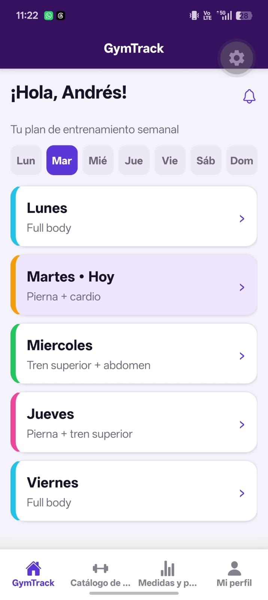
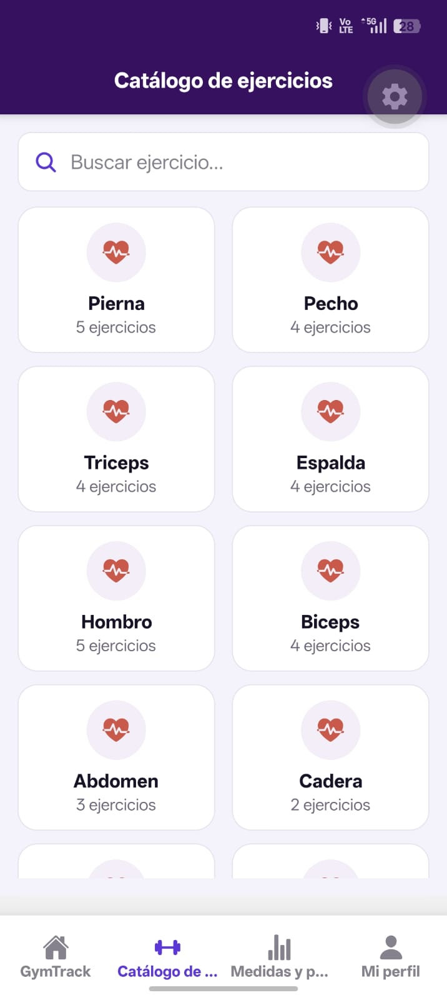
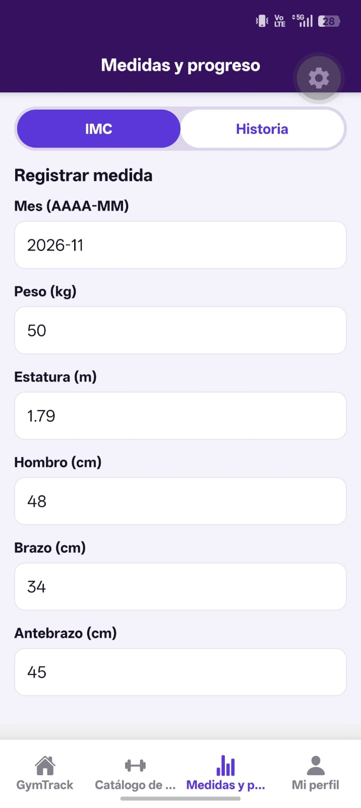

# GymTrack

Aplicacion movil para la gestion de rutinas de entrenamiento y seguimiento del progreso fisico.

## Tecnologias utilizadas

- React Native
- Expo SDK 57
- TypeScript
- Expo Router

## Documentacion del proyecto

[Consultar documentacion completa](gymtrack/README.md)

## Capturas de la aplicacion

| Inicio | Catalogo |
| :---: | :---: |
|  |  |

| Medidas | Perfil |
| :---: | :---: |
|  |  |
