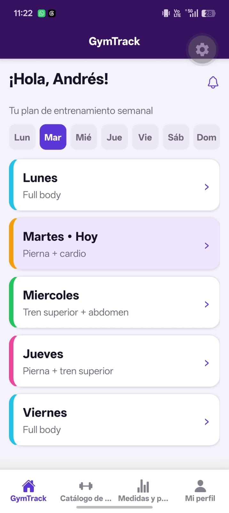
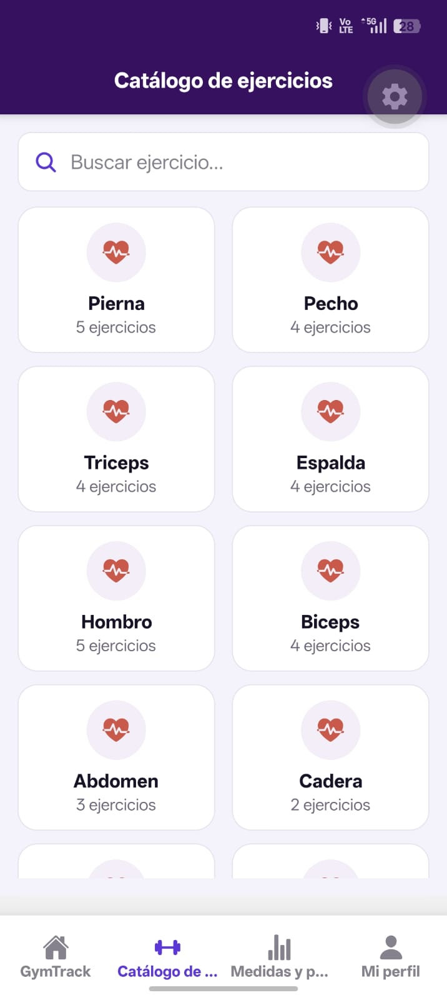
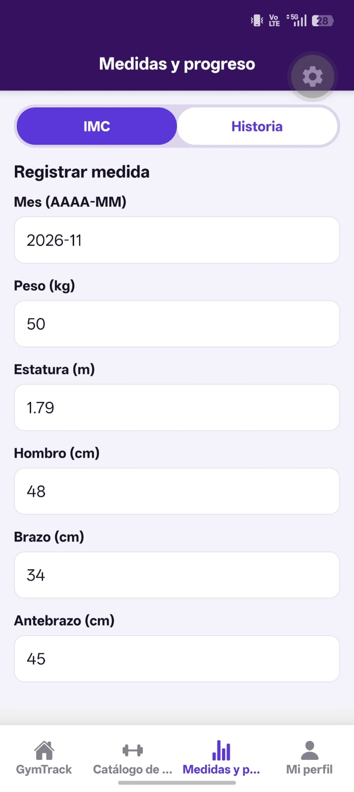
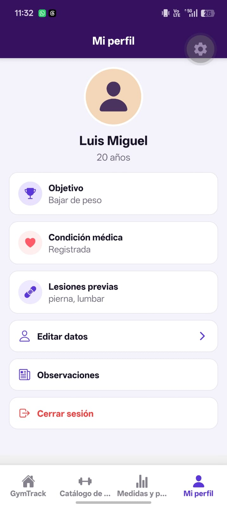

# GymTrack - Laboratorio integrado final

Aplicación móvil desarrollada con Expo Router, React Native y TypeScript para digitalizar la ficha de entrenamiento de un gimnasio.

## Integrantes
- Luis miguel rosero 
- juan pablo yucuma 

## Entorno requerido
- Node.js 24 LTS
- Expo SDK 57: `"expo": "~57.0.34"`
- Expo Go compatible con SDK 57
- npm

## Instalación
```bash
npm install
npx expo install --check
npx tsc --noEmit
npx expo lint
npx expo start --clear
```
Escanea el QR con Expo Go. `npx expo install --fix` alinea versiones compatibles con la versión exacta de Expo instalada.

## Estado de requisitos
| Requisito | Estado |
|---|---|
| RF01 Plan semanal de 6 días con color y día actual | Cumplido |
| RF02 Detalle del día y calentamientos | Cumplido |
| RF03 Catálogo de 11 grupos musculares | Cumplido |
| RF04 Filtro por nombre sin mayúsculas ni tildes | Cumplido |
| RF05 Detalle de ejercicio, grupo, esquema y días asignados | Cumplido con marcador visual |
| RF06 Sesiones completadas y barra de progreso | Cumplido |
| RF07 Perfil controlado y validado | Cumplido |
| RF08 Mes, estatura, peso, perímetros e IMC | Cumplido |
| RF09 Advertencias por lesión | Cumplido |
| RF10 Temporizador de descanso de 60 segundos | Cumplido |
| RF11 Persistencia con AsyncStorage | Cumplido |

## Capturas
Pendientes de adjuntar al README antes de entregar: Inicio, Catálogo, Medidas y Perfil.

## Video demostrativo
Pendiente: grabación menor de 5 minutos mostrando RF01-RF08 en un dispositivo.

## Bitácora de investigación
| Tema | Fuentes consultadas | Aprendizaje aplicado |
|---|---|---|
| T1 Context | https://react.dev/reference/react/useContext | `createContext`, `Provider`, `useContext` y `useGym` permiten compartir perfil, medidas y sesiones sin prop drilling. El hook lanza un error si se usa fuera del provider. Aplicado en `context/GymContext.tsx`. |
| T2 Expo Router | https://docs.expo.dev/router/introduction/ y https://docs.expo.dev/router/advanced/tabs/ | Los grupos `(tabs)` crean pestañas y los archivos `[dia].tsx`, `[grupo].tsx` y `[id].tsx` crean rutas dinámicas. Aplicado en `app/`. |
| T3 useEffect | https://react.dev/reference/react/useEffect | `useEffect` inicia y limpia `setInterval` según el estado activo. La limpieza evita intervalos al salir de la pantalla. Aplicado en `app/ejercicio/[id].tsx`. |
| T4 Formularios | https://reactnative.dev/docs/textinput y https://reactnative.dev/docs/keyboardavoidingview | Los formularios usan estado controlado, `keyboardType`, conversiones numéricas y mensajes de error. Aplicado en perfil y medidas. |
| T5 Diseño adaptable | https://reactnative.dev/docs/safe-area-view y https://reactnative.dev/docs/flexbox | SafeAreaView protege el contenido y `useWindowDimensions` cambia la cuadrícula entre 2 y 3 columnas. Aplicado en pantallas y componentes. |
| T6 TypeScript y arreglos | https://www.typescriptlang.org/docs/handbook/2/narrowing.html | `map`, `filter`, `find`, `Record`, tipos unión y estrechamiento tipan el dominio y encuentran los días de un ejercicio. `normalize('NFD')` elimina tildes para buscar. |
| T7 Imágenes locales | https://reactnative.dev/docs/images | Se usa un marcador visual porque el proyecto no incluye el conjunto de recursos. Las imágenes locales deben registrarse con `require` y no con rutas dinámicas construidas como texto. |
| T8 AsyncStorage | https://react-native-async-storage.github.io/async-storage/docs/usage/ | `getItem`, `setItem`, `JSON.stringify` y `JSON.parse` permiten persistir perfil, medidas y sesiones. No es apropiado para secretos. Aplicado en `GymContext.tsx`. |

## Reflexión técnica
Se decidió centralizar el estado compartido en `GymContext` para que perfil, medidas y sesiones estuvieran disponibles en todas las rutas sin pasar props entre varios niveles. La dificultad principal fue validar datos heterogéneos recibidos como texto y persistirlos sin romper el modelo tipado; se resolvió usando conversiones explícitas, guardas y tipos como `Record<Perimetro, number>`.

## Propuesta de integración con IA

### Definición del problema
El proyecto busca digitalizar la ficha de entrenamiento de un gimnasio. La información del plan semanal, ejercicios, perfil del socio, lesiones, medidas corporales y ejercicios completados está repartida entre una ficha y el seguimiento manual. Esto dificulta consultar el entrenamiento de cada día, mantener un historial de progreso y tener en cuenta los datos del socio al revisar su plan. Esta formulación se deriva del objetivo y los requisitos descritos en este README; no se encontró aquí una definición formal del problema copiada de otro documento.

### Papel asumido
El papel del estudiante es el de responsable del análisis, diseño, implementación y verificación de la solución. La IA se plantea como una herramienta de apoyo para organizar información y elaborar sugerencias explicables; no reemplaza al entrenador, no diagnostica y no decide por cuenta propia qué ejercicios debe realizar una persona. La integración con IA todavía no forma parte de la aplicación implementada.

### Cómo se resolvería
1. Definir con el entrenador un alcance acotado: por ejemplo, generar un borrador de recomendaciones semanales a partir del objetivo, plan y progreso registrados.
2. Preparar solo los datos necesarios y pedir consentimiento antes de enviar información a un proveedor externo. No enviar nombre ni otros identificadores; las lesiones y medidas también son datos sensibles.
3. Enviar la solicitud desde un servicio backend controlado por el proyecto. Las credenciales del proveedor se guardarían en el servidor, nunca en la aplicación Expo ni en el repositorio.
4. Validar la respuesta con un esquema tipado, mostrarla como sugerencia revisable y ofrecer una alternativa clara si el servicio falla. La rutina existente seguiría disponible sin conexión a la IA.
5. Probar respuestas inválidas, datos incompletos, lesiones registradas y fallos de red. Un entrenador debe revisar las recomendaciones antes de que se presenten como plan de entrenamiento.

La primera versión debería limitarse a resumir el progreso y proponer preguntas o ajustes para revisión humana. No debería prescribir tratamientos, diagnosticar lesiones ni prometer resultados de salud. El cálculo actual del IMC es informativo y tampoco constituye una evaluación médica.

### Uso de IA durante el desarrollo
Según la bitácora y reflexión del proyecto, se usó GitHub Copilot como apoyo para implementar y revisar componentes, investigar patrones de las tecnologías empleadas, corregir errores de compilación y contrastar el trabajo con los requisitos. La persona responsable debe revisar las sugerencias, ejecutar las comprobaciones del proyecto y poder explicar el código entregado; la IA no sustituye esa revisión.

No se integró un modelo de IA en GymTrack: las dependencias y el código actuales no contienen un cliente o servicio de IA. En este entorno la herramienta identificable es GitHub Copilot en Visual Studio Code, pero el nombre exacto del modelo seleccionado no está expuesto en el repositorio ni en esta conversación. Para informarlo con certeza, hay que consultar el selector de modelo de Copilot en VS Code; no se debe atribuir un modelo específico sin verificarlo.

### Prompt reutilizable para diseñar la integración

```text
Actúa como un ingeniero de software senior que trabaja sobre GymTrack, una aplicación móvil existente hecha con Expo Router, React Native y TypeScript. Antes de proponer cambios, inspecciona el código y confirma cómo se representan actualmente el plan semanal, los ejercicios, el perfil del socio, las lesiones, las medidas, el IMC, el progreso y la persistencia en AsyncStorage.

Contexto del problema: GymTrack digitaliza la ficha de entrenamiento y el seguimiento del socio. Queremos evaluar una futura función de IA que ayude a resumir el progreso o redactar sugerencias semanales revisables por un entrenador. La aplicación actualmente no tiene integración con IA.

Tu papel es proponer una solución pequeña, compatible con la arquitectura y las dependencias existentes, explicar sus decisiones y verificarla. No afirmes que una función está implementada si no lo está. Primero presenta el flujo de datos, los cambios mínimos, los riesgos y las pruebas; después implementa únicamente el alcance acordado.

Requisitos y límites:
- Mantén Expo Router, React Native, TypeScript y los patrones actuales del proyecto.
- No pongas claves ni secretos en la app móvil, AsyncStorage, el repositorio o variables públicas del cliente. Si se usa un proveedor externo, propón un backend intermediario y valida allí las solicitudes.
- Solicita consentimiento explícito y minimiza o desidentifica los datos enviados. Trata lesiones y medidas corporales como datos sensibles.
- La IA puede resumir el progreso y generar borradores para revisión humana; no diagnostica, prescribe tratamientos ni sustituye al entrenador o a un profesional de salud.
- No cambies ni reemplaces el plan vigente automáticamente. Valida la respuesta con tipos/esquema, presenta errores y permite seguir usando la app cuando el servicio no esté disponible.
- Incluye pruebas para datos incompletos, lesiones registradas, respuesta inválida, error de red y ausencia de consentimiento.
- No agregues dependencias ni modifiques archivos fuera del alcance sin justificarlo. Ejecuta las comprobaciones apropiadas y resume archivos modificados, resultados y limitaciones.
```

## Capturas de la aplicación

| Inicio | Catálogo |
| :---: | :---: |
|  |  |
| Plan semanal de entrenamiento | Catálogo de ejercicios |

| Medidas | Perfil |
| :---: | :---: |
|  |  |
| Registro de medidas corporales | Información del socio |

